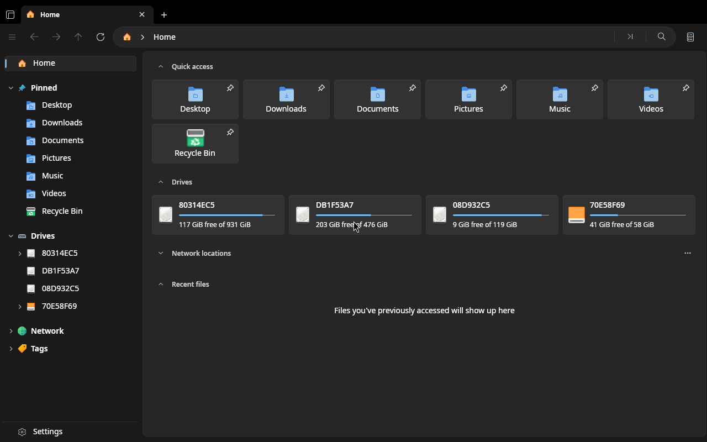

<p align="center">
  
</p>

# LinuxFiles

LinuxFiles is an independent Linux-only file manager built with C#/.NET 10 and Uno Platform's Skia desktop host. Alpha6 prefers native Wayland through the forked Uno 6.7.135-wayland.5 packages and falls back to X11/XWayland, without Windows or Wine.

Based on [Files](https://github.com/files-community/Files) by the [Files Community](https://github.com/files-community) and its [contributors](https://github.com/files-community/Files/graphs/contributors), this fork is not affiliated with or endorsed by the Files Community. LinuxFiles has no Windows support or upstream sync. Individual upstream fixes may be brought over selectively with attribution; see the [upstream policy](../docs/linux-port/upstream-policy.md).

**Status: alpha.** Expect missing features and rough edges. Keep backups and report problems in [this fork's issue tracker](https://github.com/MemerGamer/LinuxFiles/issues).

## Features

- Tabs, Home and sidebar navigation, Details/List/Grid/Cards layouts, sorting and grouped views.
- Copy, move, rename, delete, trash and restore; file clipboard and X11 drag and drop.
- Archive browsing and extraction, search, file previews, tags and a Properties window with POSIX permissions.
- UDisks2 drive mounting and ejecting, GVfs network/MTP locations, desktop file launchers and KDE service menus.
- Open with, templates, terminals, desktop portal pickers and FileManager1 integration.
- Appearance settings, system colours and optional polkit-authenticated root operations in supported native packages.

See the [showcase](../docs/linux-port/SHOWCASE.md) for screenshots and [packaging details](../docs/linux-port/packaging.md) for integration requirements.

## Known limits

- The native Wayland host is new; please report compositor, scaling, input or packaging issues. WebView and MediaPlayer are unsupported on Wayland, and outgoing drag-and-drop to other applications is not implemented there. Force X11/XWayland with `UNO_SKIA_HOST=x11`; see [Troubleshooting](#troubleshooting).
- AT-SPI accessibility is not implemented. X11/XWayland fallback can show soft text under fractional compositor scaling.
- Select-all in folders with around 10,000 items remains slow because of Uno selection handling.
- Tags use Linux extended attributes and a local database. Extended-attribute writes can fail on read-only files or unsupported filesystems; alpha4 preserves edits in the database across reloads and restarts, but those edits cannot be written back to the file when xattrs fail.
- Release packages target x86_64. arm64 publishing is wired but untested. Network/MTP browsing requires a working GVfs session.
- AppImage, Flatpak and plain Nix installs disable root actions; see [Root actions](#root-actions).

## Install

[](https://github.com/MemerGamer/LinuxFiles/releases/tag/linux-v0.1.0-alpha6)

> [!NOTE]
> **0.1.0-alpha6 is the sixth public alpha release.** Expect rough edges and missing features, and keep backups of anything you care about. Please report problems in the [issue tracker](https://github.com/MemerGamer/LinuxFiles/issues).

Grab the assets from the [0.1.0-alpha6 release page](https://github.com/MemerGamer/LinuxFiles/releases/tag/linux-v0.1.0-alpha6). Requirements: x86_64 Linux with Wayland or X11/XWayland; the packages are self-contained, so no .NET install is needed.

### Arch Linux (AUR)

```sh
yay -S linuxfiles-bin    # or: paru -S linuxfiles-bin
```

This installs the polkit helper for optional [root actions](#root-actions); polkit and a session authentication agent are required.

### Nix / NixOS

```sh
nix run github:MemerGamer/LinuxFiles          # try it
nix profile install github:MemerGamer/LinuxFiles
```

The flake exports `overlays.default` (adds `pkgs.linuxfiles`) and `nixosModules.default`. Plain `nix run`/profile installs keep all [root actions](#root-actions) disabled. NixOS administrators can import the module and opt in:

```nix
# Add inputs.linuxfiles.nixosModules.default to your NixOS modules.
programs.linuxfiles = {
  enable = true;
  rootActions = true; # default: false
};
```

This installs a patched helper, a matching polkit action and trusted deployment manifest, and enables the pkexec wrapper. A session authentication agent is required. The flake pins alpha5, which supports this opt-in; it moves to alpha6 after the alpha6 release assets are published. A runtime-capability assertion rejects incompatible or unmarked package overrides. See [Nix packaging details](../docs/linux-port/packaging.md#nix-flake).

### AppImage

```sh
curl -LO https://github.com/MemerGamer/LinuxFiles/releases/download/linux-v0.1.0-alpha6/Files-x86_64.AppImage
chmod +x Files-x86_64.AppImage
./Files-x86_64.AppImage
```

Root actions remain disabled in the AppImage. Administrators can separately [provision a matching native host helper](../docs/linux-port/packaging.md#companion-host-helper-opt-in-appimage--flatpak), but this alone does not enable AppImage elevation.

### Flatpak bundle

```sh
curl -LO https://github.com/MemerGamer/LinuxFiles/releases/download/linux-v0.1.0-alpha6/Files-x86_64.flatpak
flatpak install --user ./Files-x86_64.flatpak
flatpak run io.github.memergamer.LinuxFiles
```

The bundle needs the `org.freedesktop.Platform//25.08` runtime and a configured Flathub remote to obtain it. It is a downloadable bundle, not a Flathub app listing. Root actions remain disabled. An optional [companion host-helper installer](../docs/linux-port/packaging.md#companion-host-helper-opt-in-appimage--flatpak) provisions the native host only; this bundle has no host-spawn bridge and keeps its sandbox permissions unchanged.

### Tarball

```sh
curl -LO https://github.com/MemerGamer/LinuxFiles/releases/download/linux-v0.1.0-alpha6/files-linux-x64.tar.gz
tar xzf files-linux-x64.tar.gz
./linux-x64/Files                      # run it in place
```

To install it for your user (menu entry, icons, `files` launcher in `~/.local`), use the script from a clone of this repository, which also supplies the desktop entry and icons:

```sh
git clone https://github.com/MemerGamer/LinuxFiles.git
cd LinuxFiles
scripts/linux/install-local.sh --from /path/to/linux-x64
```

`files-packaging.tar.gz` holds only the desktop entry, metainfo, icons, launcher and licence, for packagers (the AUR package consumes it together with the tarball above). `scripts/linux/uninstall-local.sh` reverses a local install.

### Root actions

Optional. **Open in terminal as root** uses a trusted run0, sudo or pkexec in native packages that allow elevation. Polkit-authenticated Delete/Rename/Paste-as-root requires the installed trusted helper: AUR, an opted-in local tarball install, or the NixOS module with a release containing its runtime support. AppImage, Flatpak and plain `nix run` keep all root actions disabled. In a supported native installation, start a root-mode window with:

```sh
files --root
```

or pick **Open in Root Mode** from the launcher's desktop actions. Each action asks for authentication for that exact operation, and the GUI itself stays unprivileged. See the [elevation threat model](../docs/linux-port/threat-model-elevation.md).

### Verify downloads

Download `SHA256SUMS` next to the files you fetched and check them (missing files are reported, not fatal, with `--ignore-missing`):

```sh
sha256sum -c --ignore-missing SHA256SUMS
```

### Nightly builds

Every merge to `main` publishes a tarball and AppImage to the rolling [nightly pre-release](https://github.com/MemerGamer/LinuxFiles/releases/tag/nightly). It is untested bleeding edge. Run it with:

```sh
curl -LO https://github.com/MemerGamer/LinuxFiles/releases/download/nightly/LinuxFiles-nightly-x86_64.AppImage && chmod +x LinuxFiles-nightly-x86_64.AppImage && ./LinuxFiles-nightly-x86_64.AppImage
```

### More

- [CHANGELOG.md](../CHANGELOG.md): what is in each release
- [Showcase](../docs/linux-port/SHOWCASE.md): screenshots and the feature checklist
- [Packaging details](../docs/linux-port/packaging.md) and the [roadmap](../docs/linux-port/PLAN.md)

## Troubleshooting

**Choose a host (alpha6):** `UNO_SKIA_HOST=x11 files` forces X11/XWayland; `UNO_SKIA_HOST=wayland files` requires native Wayland. The default chooses Wayland when available and falls back to X11 when Wayland host probing fails or `WAYLAND_DISPLAY` is unset. Restart Files when switching. See [host and package details](../docs/linux-port/wayland-packages.md).

**Soft text or icons with X11/XWayland fallback on niri / xwayland-satellite:** Enable **Detect display scale from the compositor (experimental)** in Settings > Appearance and restart Files to use niri's focused output scale when no Uno, Xft, GDK or Qt scale hint is present and both `NIRI_SOCKET` and `WAYLAND_DISPLAY` are set. Check stderr for `[display-scale]` to see whether IPC or CLI detection succeeded. Detection defaults off and may double-scale on some setups. `FILES_NIRI_SCALE=1` forces it on and `FILES_NIRI_SCALE=0` forces it off, overriding the saved preference. Launch with `UNO_DISPLAY_SCALE_OVERRIDE=1.25 files` to select a scale manually (replace `1.25` with your output scale). The scale is chosen at startup. See [display scale details](../docs/linux-port/appearance-transparency.md#display-scale-on-niri).

## Building from source

Install the .NET 10 SDK and the native Linux dependencies: fontconfig, FreeType, Wayland client/cursor/EGL libraries, xkbcommon, X11 libraries (Xcursor, Xrandr, Xi and Xext), Mesa/OpenGL/EGL and GLib. Run with a Wayland compositor or X11/XWayland. Fetch the pinned Uno fork packages from its public GitHub Release before restoring (Bash, Python 3, curl, coreutils and util-linux required). See the [AUR recipe](../packaging/linux/aur/linuxfiles-bin/PKGBUILD) for Arch package names and [package setup](../docs/linux-port/wayland-packages.md) for the initial publisher step.

```sh
git clone https://github.com/MemerGamer/LinuxFiles.git
cd LinuxFiles
build/fetch-uno-wayland.sh
build/clear-uno-wayland-cache.sh
dotnet build src/Files.App -f net10.0-desktop
```

To build with upstream X11 packages, use `dotnet build src/Files.App -f net10.0-desktop -p:UseUnoWayland=false`; no fork fetch is needed. `scripts/linux/publish.sh --x11` provides the same opt-out for publishing.

For self-contained publishing and a user-local install:

```sh
scripts/linux/publish.sh
scripts/linux/install-local.sh
```

Publishing the Native AOT elevation helper also requires clang and zlib development files. See [packaging](../docs/linux-port/packaging.md) for package builds and helper installation, and [CONTRIBUTING.md](../CONTRIBUTING.md) for validation instructions.

## Reporting bugs

- **Linux bugs and Linux feature requests:** open an issue in [this fork](https://github.com/MemerGamer/LinuxFiles/issues).
- **Security issues:** use this fork's private [Security Advisories](https://github.com/MemerGamer/LinuxFiles/security/advisories/new). See [SECURITY.md](./SECURITY.md).

## Contributing

Submit focused pull requests to `main` in [MemerGamer/LinuxFiles](https://github.com/MemerGamer/LinuxFiles), using the PR template. Disclose AI-assisted work and include `Co-Authored-By` trailers for co-authors. See [CONTRIBUTING.md](../CONTRIBUTING.md) for development, validation and attribution requirements.

## Credits

- **[Files Community](https://github.com/files-community)** and all [upstream contributors](https://github.com/files-community/Files/graphs/contributors): the Files app, its design, code and translations (via [Crowdin](https://crowdin.com/project/files-app)) that this port is built on. Files is licensed under the MIT License, with some files under the Mozilla Public License 2.0 (MPL-2.0), Copyright (c) 2018 - present Files Community.
- **[Uno Platform](https://platform.uno/)**: WinUI on Skia for Linux, including the [native Wayland fork](https://github.com/MemerGamer/uno/tree/wayland/host), which makes this port possible.
- **[SkiaSharp](https://github.com/mono/SkiaSharp)**, **[Selawik](https://github.com/microsoft/Selawik)** (UI font) and **Uno.Fonts.Fluent** (icons).
- **[Tmds.DBus](https://github.com/tmds/Tmds.DBus)**, **[TagLibSharp](https://github.com/mono/taglib-sharp)**, **[Markdig](https://github.com/xoofx/markdig)**, **[ColorCode](https://github.com/CommunityToolkit/ColorCode-Universal)**, **[LibGit2Sharp](https://github.com/libgit2/libgit2sharp)**, **[FluentFTP](https://github.com/robinrodricks/FluentFTP)**, **[SharpCompress](https://github.com/adamhathcock/sharpcompress)**, **[7-Zip](https://www.7-zip.org/)** and the .NET Community Toolkit.

The full list of third-party components and licenses is in [NOTICE.md](../NOTICE.md) and [.github/NOTICE.md](./NOTICE.md). "Files" and its logo are the Files Community's; they are used here to identify the upstream project and its Linux port, with no endorsement implied.

## License

LinuxFiles is licensed under the MIT License and the Mozilla Public License 2.0, like Files. Files that carry a Mozilla Public License header are covered by [LICENSE-MPL](../LICENSE-MPL), and changes to those files stay under MPL-2.0. All other code, including the LinuxFiles additions, is covered by [LICENSE-MIT](../LICENSE-MIT): Copyright (c) 2018 - present Files Community; Copyright (c) 2026 LinuxFiles contributors (Linux modifications). Preserve both licenses, applicable file headers, contributor attribution and [NOTICE.md](../NOTICE.md), including the inherited [third-party notices](./NOTICE.md).
